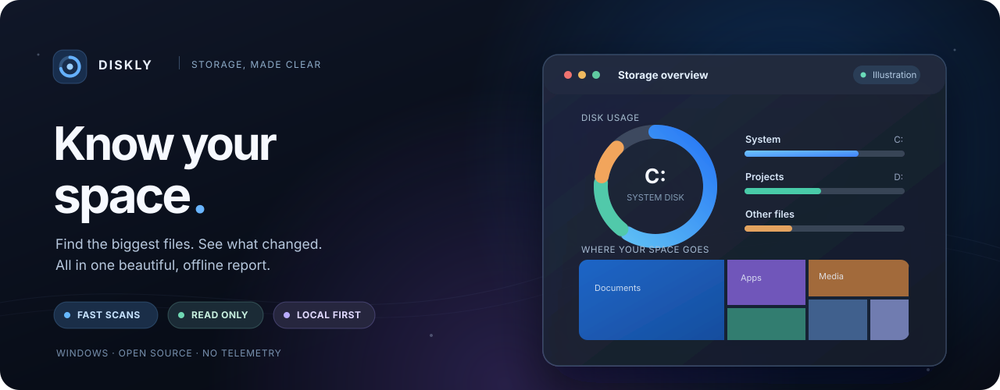

  

<h1 align="center">Diskly</h1>

  <strong>See where your disk space went — and what changed.</strong> 
  A fast, read-only Windows disk analyzer with a beautiful, interactive report that works completely offline.

  
  
  
  
  

  <a href="https://github.com/seiya058904/Diskly/releases/latest"><strong>↓ Download for Windows</strong></a>
  &nbsp;·&nbsp; <a href="#preview">Screenshots</a>
  &nbsp;·&nbsp; <a href="#features">Features</a>
  &nbsp;·&nbsp; <a href="#performance">Performance</a>
  &nbsp;·&nbsp; <a href="#get-started">Get started</a>
  &nbsp;·&nbsp; <a href="#development">Build</a>

简体中文界面 · No account · No telemetry · No network requests · No file deletion

---

## 🪟 A clearer picture of your storage

Open Diskly, press **扫描** (Scan), and your browser opens a self-contained report. See what takes up space, which folders changed since the previous scan, and which files deserve a closer look.

   
  The real report interface, rendered with made-up data to protect private file paths. Click to enlarge.

<table>
  <tr>
    <td width="50%" valign="top">
       
      <strong>Explore the space map</strong> 
      Drill into folders, inspect their size, and color tiles by change.
    </td>
    <td width="50%" valign="top">
       
      <strong>Find the biggest files</strong> 
      Filter by type, copy a path, or open the containing folder.
    </td>
  </tr>
</table>

<strong>📈 See trends and the small launcher window</strong>

   
  History, filling rate and a forecast based on recorded scans.

<table>
  <tr>
    <td width="33%" align="center"> Ready to scan</td>
    <td width="33%" align="center"> Scanning</td>
    <td width="33%" align="center"> Settings &amp; footprint</td>
  </tr>
</table>

The launcher images show the real app. The report images use synthetic data; none reveal a user's actual scan results.

## ✨ Just the things you need

<table>
  <tr>
    <td width="50%" valign="top"><strong>⚡ Scan without the wait</strong>  Read the NTFS file table directly for fast scans. Diskly falls back to ordinary folder traversal when elevation is declined or the drive is not NTFS.</td>
    <td width="50%" valign="top"><strong>🧭 See what actually changed</strong>  Compare recent scans, track growth and shrinkage by folder and file, and follow each disk even when its drive letter changes.</td>
  </tr>
  <tr>
    <td valign="top"><strong>🗂️ Understand the big picture</strong>  Interactive treemap, largest files and folders, categories by extension, and explanations for common space-consuming locations such as caches, Docker, WSL and the Recycle Bin.</td>
    <td valign="top"><strong>📊 Keep the long view</strong>  See disk usage trends over time, estimated filling rates, and a forecast. Reports are standalone HTML files you can reopen offline.</td>
  </tr>
  <tr>
    <td valign="top"><strong>🛡️ Inspect, never delete</strong>  Diskly reads file names and sizes, not file contents. It never deletes, cleans or modifies your files; uncertain or unreadable folders stay marked unknown.</td>
    <td valign="top"><strong>🤖 Bring your own AI</strong>  Use <strong>复制给 AI</strong> (Copy for AI) to preview and copy a text summary. Diskly never sends it anywhere — sharing is your decision.</td>
  </tr>
</table>

The interface takes cues from iOS: true black, restrained glass effects, spring-like interactions and smooth, focused movement.

## ⚡ Fast on real disks. Small over time.

| Measured on one Windows 11 PC | Observed |
| :-- | --: |
| **Fast scan** · 2 NVMe drives, ~730,000 files | **1.50 s** |
| First fast scan after a while | **3.65 s** |
| **Normal scan**, including saving · same drives | **5.76–6.55 s** |
| Offline report ready · headless Chrome test | **321 ms** |
| Program + retained data + WebView2 cache | **≈26 MB** on the test PC |

Measurements used an **i7-12700H**, two NVMe SSDs and files largely cached by Windows; scan timings exclude the time spent responding to the administrator prompt. Results vary with drive size, file count, cache state and hardware. The page measurement is from a headless browser, not a guarantee of physical GPU smoothness.

Diskly is designed to keep its **total disk footprint below 50 MB** during normal use, including the executable, saved scans, reports and window cache. Its storage is bounded rather than growing with every scan; the limit has exceptions for very large volumes and interrupted scans. [See the measured footprint and test boundaries](docs/benchmarks/2026-11-speed-and-footprint.md).

## 📦 Download. Scan. Explore.

**[Get the latest Diskly release →](https://github.com/seiya058904/Diskly/releases/latest)**

| v0.2.0 · Windows x64 | Download |
| :-- | :-- |
| **Installer · ~2.3 MiB** | [Diskly-0.2.0-setup.exe](https://github.com/seiya058904/Diskly/releases/download/v0.2.0/Diskly-0.2.0-setup.exe) — installs for the current user, without installation-time elevation |
| **Portable · ~8.7 MiB** | [Diskly-0.2.0-portable.exe](https://github.com/seiya058904/Diskly/releases/download/v0.2.0/Diskly-0.2.0-portable.exe) — run directly; needs Microsoft Edge WebView2 |
| **Checksums** | [SHA256SUMS.txt](https://github.com/seiya058904/Diskly/releases/download/v0.2.0/SHA256SUMS.txt) — verify your download |

1. **Open Diskly** and press **扫描**. The default fast scan asks Windows for administrator permission. If you decline, Diskly uses normal scanning and tells you.
2. **Read your report** in the default browser. The first scan establishes a baseline; later scans show changes.
3. **Explore** by disk, file type and folder. Choose two compatible scans to compare, or copy a reviewed summary for an AI assistant.

**Compatibility:** Tested on **Windows 11 x64**. Windows 10 is expected to work, but is not verified here; it will not have the same frosted launcher background. WebView2 is included with Windows 11.

<strong>🔐 Unsigned downloads, UAC and checksum verification</strong>

The binaries are **not code-signed**, so Windows SmartScreen may show a reputation warning. Download only from this repository's release page and check the published hash before running the file.

~~~powershell
Get-FileHash .\Diskly-0.2.0-setup.exe -Algorithm SHA256
~~~

Installation itself is per-user. **Fast scanning** is a separate action: a short-lived, read-only helper requests administrator rights for direct NTFS access; the main window never runs elevated. You may cancel a scan at any time. Declining elevation falls back to normal scanning.

## 🔎 Two ways to look at a disk

| | **Fast scan** · default | **Normal scan** · fallback |
| :-- | :-- | :-- |
| Reads | NTFS file table (MFT) | Folder tree |
| Permissions | Administrator prompt for each scan | Standard user |
| Drives | NTFS; other filesystems use fallback | Filesystems accessible to Windows |
| Coverage | Includes entries ordinary folder traversal may miss | Unreadable folders explicitly marked unknown |
| Comparison | Compared only with prior fast scans | Compared only with prior normal scans |

Diskly prioritizes **truthful changes over impressive-looking numbers**:

- Unreadable folders are **unknown, never zero**; they are not counted as space freed.
- A missing disk retains its previous result instead of appearing emptied. A reformatted disk starts a new history.
- Cancelled or differently scanned snapshots are not used for misleading folder-to-folder comparisons.
- Windows' used-space total and scanned folder totals can differ because of hard links, shadow copies and filesystem metadata.

## 🔒 Your files stay yours

Diskly works locally, with **no account, telemetry, background service or app-initiated network requests**. It reads file names and sizes, not their contents. It does not offer a delete or cleanup action.

The report is a standalone HTML file. **It can contain private folder and file names**, so review it before sharing. The Copy for AI text hides account and organization names by default and can hide names inside personal folders, but other paths can remain. You preview the text before copying; Diskly does not upload it.

<strong>📁 Storage, retention and known limits</strong>

Diskly stores its own data in `%LOCALAPPDATA%\Diskly`. On the measured machine, the program was ~8.7 MB, retained data roughly 11–21 MB depending on scan modes, and the WebView2 folder ~2–4 MB.

- **Recent scans:** last three per disk. Older snapshots retain folders rather than full file lists; only the newest scan for each engine keeps its file details.
- **Reports:** last three ready-made reports. Older ones are regenerated from retained data when opened.
- **Long-term history:** small, gradually thinned records for disk trends. The app limits and cleans only **its own** stored files.
- **Exception — extremely large volumes:** millions of files may not fit in one full snapshot. A scan may temporarily exceed the 50 MB footprint target; this has not been tested on such a volume.
- **Exception — interrupted fast scans:** a power failure during the elevated helper's short run may leave temporary files requiring administrator rights to remove.
- **Memory ≠ disk usage:** the measured launcher private memory was about 165 MB, mostly WebView2; the 50 MB goal describes **disk storage**, not RAM.

To remove all locally stored history after uninstalling or deleting the portable executable, remove `%LOCALAPPDATA%\Diskly` manually.

[Detailed footprint results](docs/benchmarks/2026-11-speed-and-footprint.md) · [Scanner accuracy and acceptance](docs/benchmarks/2026-11-core-acceptance.md)

## 🛠️ Build from source

**Rust · Tauri 2 · JavaScript · Windows** — requires Rust and Node.js 22 or newer.

~~~powershell
# Core and report logic
cargo fmt --all --check
cargo clippy --workspace --all-targets -- -D warnings
cargo test --workspace
node --test report/lib.test.js

# Generate an offline demo and test its report in a real browser
./scripts/e2e/build-demo.ps1 -Out $env:TEMP\diskly-demo
node scripts/e2e/report.e2e.mjs $env:TEMP\diskly-demo $env:TEMP\diskly-shots

# Build the real Windows app and its download packages
cargo build -p diskly --release
./scripts/package.ps1
~~~

Packaging writes the installer, portable executable and SHA-256 sums to `dist\`. Real-disk app tests use `scripts/e2e/app.e2e.mjs` and should be run with an isolated test data directory.

<strong>Explore the architecture and verification</strong>

| Path | Responsibility |
| :-- | :-- |
| `crates/diskghost-core` | Upstream NTFS / folder-walk scanning engine |
| `crates/diskly-core` | Volumes, history, comparisons and report data |
| `app` | Desktop launcher and elevated scan helper |
| `report` | Offline HTML report and its logic |
| `scripts` | Tests, synthetic demos, measurements and packaging |

Run browser smoothness checks with `scripts/e2e/smooth.mjs`. The [benchmark reports](docs/benchmarks) explain the conditions, accuracy tests and remaining coverage gaps.

<strong>🇨🇳 简体中文 · 快速了解</strong>

**Diskly 是一款轻量、只读的 Windows 磁盘空间分析工具。** 点击「扫描」，即可在浏览器中查看离线可交互报告：磁盘容量、占用最大的文件和目录、文件类型分布、空间地图，以及与上次扫描相比的变化和长期趋势。

默认使用 NTFS 高速扫描，需要单次管理员授权；拒绝授权后会自动回退到普通扫描。**不会删除或修改文件，不主动联网，也不会自动向 AI 上传数据。** v0.2.0 提供 [安装版和便携版](https://github.com/seiya058904/Diskly/releases/tag/v0.2.0)，界面为简体中文。测速结果来自特定测试机器，不能视为所有电脑的固定速度。

## 🌱 Built on Diskghost

Diskly is an independent, read-only application built on **[Diskghost](https://github.com/kingchenc/diskghost)** by kingchenc. It preserves the upstream Git history and scanning engine, with documented corrections, while adding a new launcher, local history, comparison and a visual offline report. Diskghost's duplicate finder and file-deletion features are **not part of Diskly**.

Licensed under **[MIT](LICENSE)**. Original work and modifications are credited in [NOTICE](NOTICE).

---

  <strong>Less guessing. More space to breathe.</strong> 
  <a href="https://github.com/seiya058904/Diskly/releases/latest">Download Diskly</a>
  &nbsp;·&nbsp; <a href="https://github.com/seiya058904/Diskly/issues">Feedback</a>
  &nbsp;·&nbsp; <a href="#top">Back to top ↑</a>

