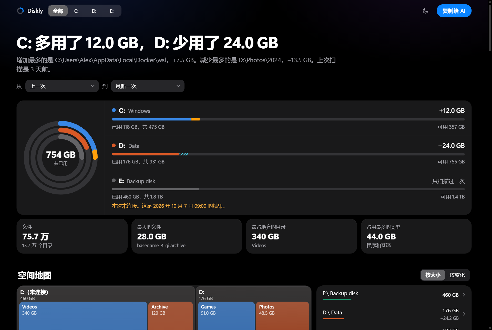
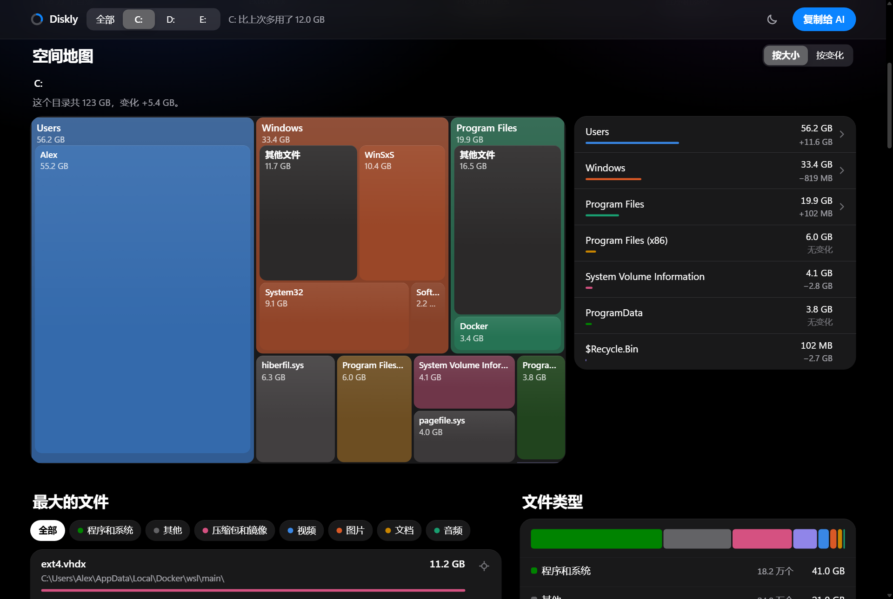
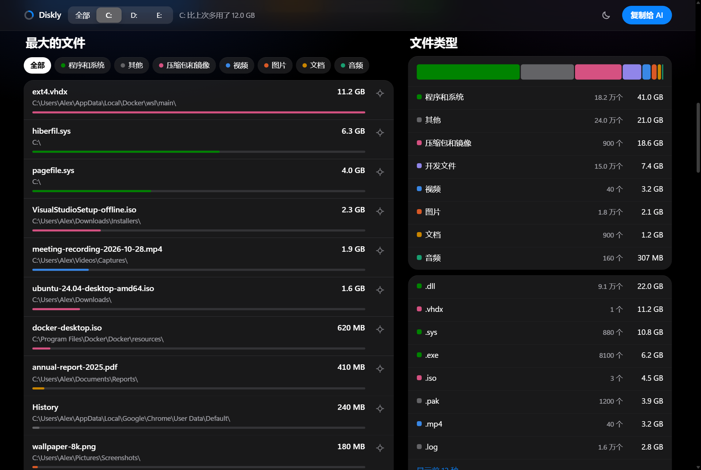
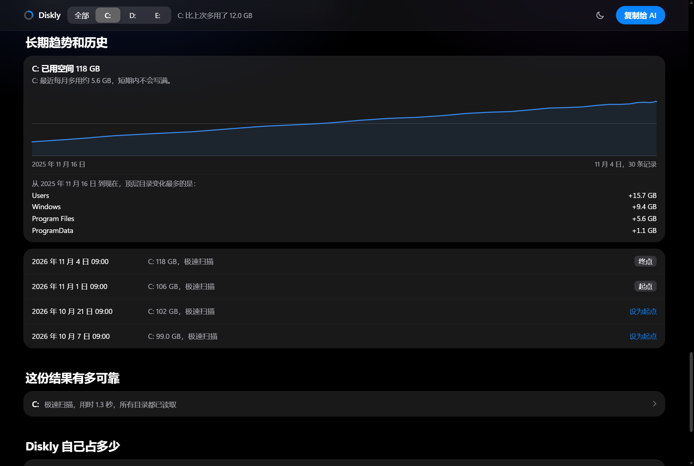
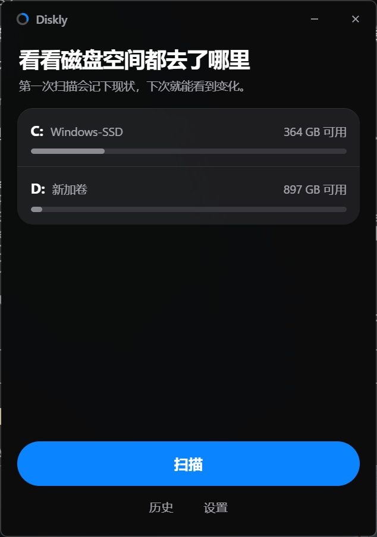
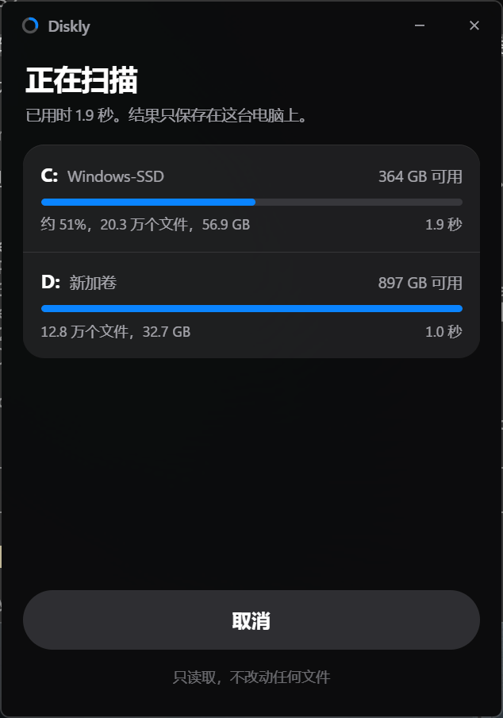
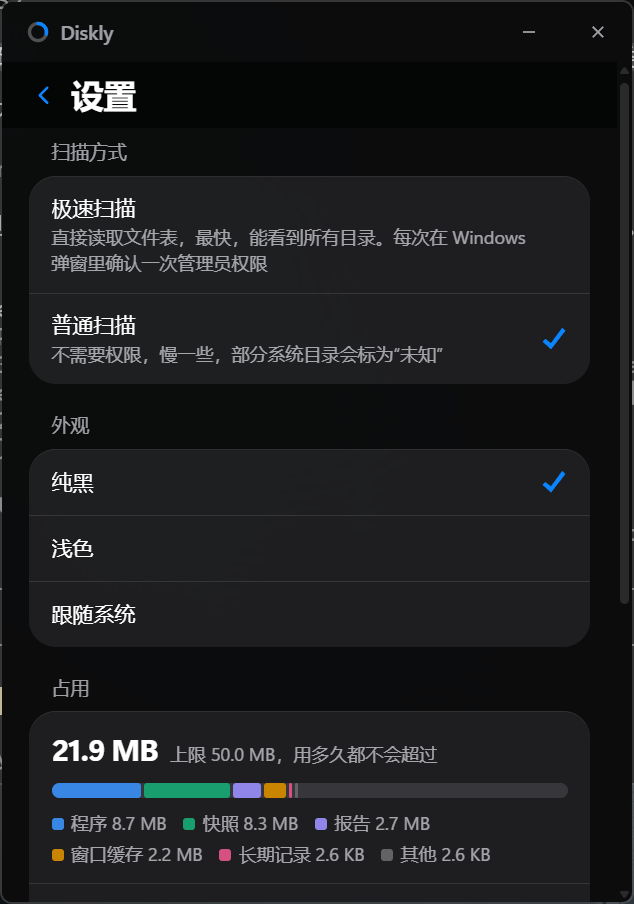

<h1 align="center">Diskly</h1>

<p align="center"><strong>See where your disk space went, in seconds.</strong></p>

<p align="center">
  Press Scan and confirm the Windows prompt. About three seconds later, a report opens in your browser: a map of every disk, the biggest files and folders, and what changed since last time.<br>
  It stays under 50 MB however long you use it. It only reads, and it never goes online.
</p>

<p align="center">
  
</p>

<p align="center">
  <a href="https://github.com/seiya058904/Diskly/releases/latest"><strong>Download for Windows</strong></a>
  <br><sub>Installer 2.3 MB. Portable file 8.7 MB. The interface is in Chinese.</sub>
</p>

## Why Diskly

### It is fast

Diskly reads the NTFS file table directly, the same idea that makes WizTree quick, instead of opening folders one by one.

| Two NVMe disks, about 730,000 files in total | Time |
|---|---:|
| Fast scan (the default) | **1.5 s** |
| Saving, and writing the report | about 1 s |
| The report on screen | 0.35 s |
| Normal scan, if you decline administrator rights | 5.3 s |

These are from one machine (i7-12700H) with the disks already in the Windows cache. The first fast scan after a while took 3.7 s. A larger or slower disk takes longer. The [full measurements](docs/benchmarks/2026-11-speed-and-footprint.md) say what was and was not tested.

### It stays small, for good

All of Diskly stays under **50 MB**: the program, its window's cache and its data. On the machine above it takes about **26 MB**.

- **It does not build up.** Over 15 real scans in a row, the data went 8.2, 11, 14, 14.6, then stayed at 14.9 MB. A test runs 300 scans and checks that nothing has grown.
- **It cleans up after itself.** Each scan removes what is no longer needed, and only ever Diskly's own files.
- **It shows you.** The report and the settings say what it takes now, part by part.

### The report is a pleasure to read

True black, in the style of iOS, with frosted glass where content passes under it. Buttons respond on a spring, rings sweep in, and clicking a folder flies into it.

It is also smooth by construction. Only transform and opacity animate, nothing listens to scrolling, and a choice redraws only what it changes. Scrolling a real report ran every frame within 16.8 ms, with no long tasks. That was measured on the page's main thread, in a headless browser.

<p align="center">
  
</p>

**What it shows:**

- **A map of the space.** Every folder is a tile sized by what it takes. Click to fly in, and switch to color by what changed.
- **The biggest files.** Filter by type, click to copy a path, or jump to the folder.
- **What the space is made of.** Video, images, archives, programs and more, down to each extension.
- **The folders that take the most**, down to the ones that really explain it.
- **Places worth a look.** Recycle Bin, downloads, caches, Docker and WSL, each with what it is and what the system offers for it. Diskly only tells you. It does not touch them.
- **What changed since last time**, by folder and by file.
- **The long view.** A trend for each disk over months or years, how fast it is filling, and when it would be full.

<p align="center">
  
</p>

<p align="center">
  
</p>

### You can trust the numbers

- **It only reads.** Diskly never deletes or changes your files, and a test keeps it that way.
- **It stays on your computer.** No account, telemetry or network access.
- **Unknown is not zero.** A folder that could not be read is marked unknown, with everything below it. It never counts as space freed.
- **It follows the disk, not the letter.** A disk with a new letter still compares. A formatted one starts again rather than reporting everything as deleted.

<table align="center">
  <tr>
    <td></td>
    <td></td>
    <td></td>
  </tr>
</table>

<p align="center"><sub>The window is real. The report pictures show made-up data, so no real paths are published.</sub></p>

## Get it

Download from [Releases](https://github.com/seiya058904/Diskly/releases). For 64-bit Windows 11, where it has been tested. It should also run on Windows 10, without the frosted window background.

- **`Diskly-x.y.z-setup.exe`** installs for your user only, with no administrator rights.
- **`Diskly-x.y.z-portable.exe`** runs as it is. It needs Microsoft Edge WebView2, which Windows 11 includes.

The files are not code-signed, so Windows SmartScreen may warn you the first time. Each release lists SHA-256 checksums in `SHA256SUMS.txt`.

## How to use it

1. **Open Diskly** and press **扫描** (Scan). Windows asks once for administrator rights, for the fast scan. All fixed disks are scanned, and you can cancel at any time.
2. **The report opens in your default browser.** The first scan records how things are now. From the second scan on, it also shows what changed.
3. **Look around.** Filter by disk or file type, click a tile to go into a folder, click a file to copy its path, or pick two recent scans to compare.
4. **Press 复制给 AI** (Copy for AI) to get a summary for ChatGPT, Claude or whatever you use. You see the exact text first. Diskly sends nothing itself.

Closing the browser loses nothing. Each report is one file that works offline, and the window's **历史** (History) list opens it again.

## Two ways to scan

The fast scan is the default. You can change it in **设置** (Settings).

| | Fast scan | Normal scan |
|---|---|---|
| How | Reads the NTFS file table directly | Lists folders one by one |
| Permission | Windows asks for administrator rights on each scan | None |
| What it sees | Everything, including system folders | Some system folders stay unreadable and are marked unknown |
| Disks | NTFS; others use the normal way | Any |

Administrator rights go to a small helper process that exists for that one scan and only reads. The window itself never runs elevated. If you say no, Diskly does a normal scan and says so.

## What it keeps

| | Kept | Size here |
|---|---|---:|
| Program | | 8.7 MB |
| Scans | The last 3 per disk. Only the newest keeps its files, which the next scan is compared with. Older ones keep only their folders, about a fifth of the size | about 10 MB |
| Reports | The last 3. An older one is made again when you open it | about 5 MB |
| Records | One small line per scan, kept for years and thinned with age. They drive the trend charts | a few hundred KB at most |
| Window cache | WebView2's component downloads and disk caches are turned off, and the folder is cleared if it passes 6 MB | about 2.4 MB |

If the limit is ever in reach, the oldest go first. There are two exceptions:

- **A disk with several million files** may not fit even one full snapshot. It keeps its records and report and says what it cannot compare, and during such a scan Diskly can briefly pass the limit. This has not been tried on a disk that large.
- **A power cut during a fast scan**, in the second or two it runs, can leave one set of temporary files that only an administrator can remove.

Everything lives in `%LOCALAPPDATA%\Diskly`. To remove Diskly entirely, uninstall it or delete the portable file, then delete that folder.

## What the numbers mean

Disk space is easy to measure and easy to get wrong when comparing. Diskly would rather say it does not know.

- **A missing disk is missing.** It shows as not connected, with its last result.
- **Fast and normal scans are not compared.** They measure some files differently, such as compressed system files, so comparing them would invent changes. Diskly compares like with like and says when it cannot.
- **A cancelled scan changes nothing.** It is never used as a baseline.
- **Two figures can differ.** The change in used space comes from Windows. The change in folders comes from the scan. Shadow copies, unreadable folders and file system metadata affect only the first.
- **Folder totals count each hard link.** Windows uses many of them, so folder totals can exceed the used space the system reports.

## Privacy

Diskly reads file names and sizes, never file contents.

- A report contains your folder and file names. Look through it before you share the file.
- The text for an AI hides your account and organization names by default, and can also hide the names inside your personal folders. It can still contain other folder and file names, so read it before you send it.

## Built on

The scanning engine is [Diskghost](https://github.com/kingchenc/diskghost) by kingchenc, under the MIT License. Diskly was started from it, keeps its history, and adds history, comparison and the two interfaces. A few changes were made to the engine, each with its evidence in [docs/benchmarks](docs/benchmarks). See [NOTICE](NOTICE) for what comes from where.

## Development

Needs Rust and Node 22 or newer, on Windows.

```powershell
cargo test --workspace                 # engine, history, comparison, and guards against deleting and growing
node --test report/lib.test.js         # the report's logic

# The report in a real browser, from a file:// URL
./scripts/e2e/build-demo.ps1 -Out $env:TEMP\diskly-demo
node scripts/e2e/report.e2e.mjs $env:TEMP\diskly-demo $env:TEMP\diskly-shots
node scripts/e2e/smooth.mjs $env:TEMP\diskly-demo\normal.html $env:TEMP\diskly-shots   # load time, frame times

# The real app on real disks, with its history in a test folder
cargo build -p diskly --release
node scripts/e2e/app.e2e.mjs (Resolve-Path target\release\diskly.exe) $env:TEMP\diskly-e2e basic

./scripts/package.ps1                  # installer, portable file and checksums, in dist\
```

| Folder | What is in it |
|---|---|
| `crates/diskghost-core` | The engine, from Diskghost |
| `crates/diskly-core` | Volumes, scanning, history, report data |
| `report` | The report page, with its logic in `lib.js` |
| `app` | The window, and the helper for fast scans |
| `scripts` | Browser tests, made-up data, packaging, measurements |

## License

[MIT](LICENSE)
