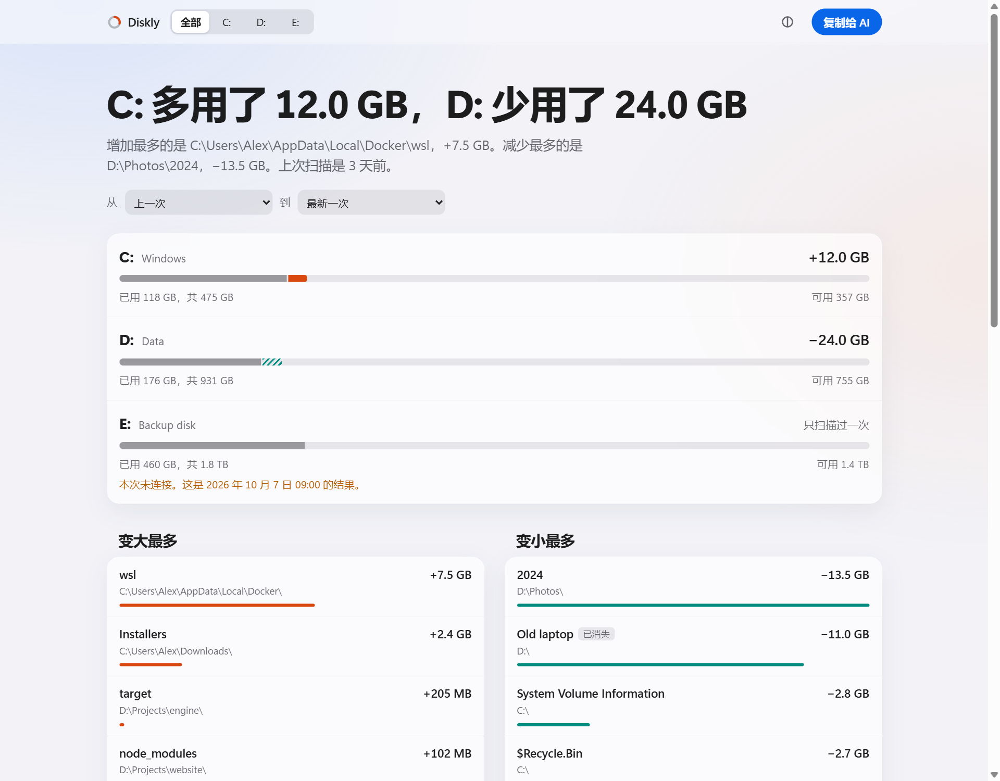
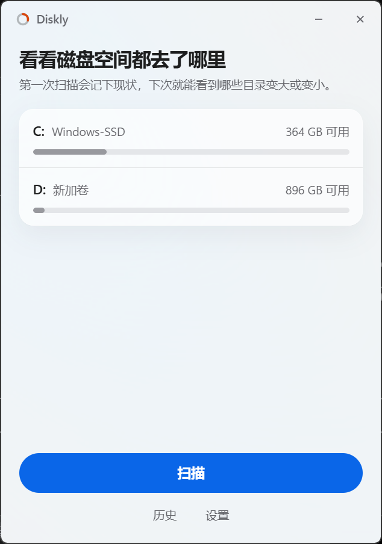

<h1 align="center">Diskly</h1>

<p align="center"><strong>See what changed on your disks since last time.</strong></p>

<p align="center">
  Press Scan. A report opens in your browser: how full each disk is, which folders grew or shrank, and what could not be read.<br>
  Diskly only reads. It never deletes or changes your files, and it never goes online.
</p>

<p align="center">
  
</p>

<table align="center">
  <tr>
    <td></td>
    <td></td>
  </tr>
</table>

<p align="center"><sub>The window is real. The report above shows made-up data, so no real paths are published. The interface is in Chinese.</sub></p>

## Get it

Download from [Releases](https://github.com/seiya058904/Diskly/releases). For 64-bit Windows 11, where it has been tested. It should also run on Windows 10, without the frosted window background.

- **`Diskly-x.y.z-setup.exe`** installs for your user only, with no administrator rights.
- **`Diskly-x.y.z-portable.exe`** runs as it is. It needs Microsoft Edge WebView2, which Windows 11 includes.

The files are not code-signed, so Windows SmartScreen may warn you the first time. Each release lists SHA-256 checksums in `SHA256SUMS.txt`.

## How to use it

1. **Open Diskly** and press **扫描** (Scan). All fixed disks are scanned, and you can cancel at any time.
2. **The report opens in your default browser.** The first scan records how things are now. From the second scan on, it shows what changed.
3. **Go through what changed.** Filter by disk, click a folder to look inside, or pick any two past scans to compare.
4. **Press 复制给 AI** (Copy for AI) to get a summary for ChatGPT, Claude or whatever you use. You see the exact text first. Diskly sends nothing itself.

Closing the browser loses nothing. Each report is one file that works offline, and the window's **历史** (History) list opens any of them again.

## Two ways to scan

The first scan asks which you want. You can change it in **设置** (Settings).

| | Fast scan | Normal scan |
|---|---|---|
| How | Reads the NTFS file table directly | Lists folders one by one |
| Permission | Windows asks for administrator rights on each scan | None |
| What it sees | Everything, including system folders | Some system folders stay unreadable and are marked unknown |
| Disks | NTFS; others use the normal way | Any |

Administrator rights go to a small helper process that exists for that one scan and only reads. The window itself never runs elevated. If you say no, Diskly does a normal scan and says so.

Measured on one machine (i7-12700H, two NVMe SSDs, about 730,000 files in total, disks already cached by Windows):

| Both disks | Fast scan | Normal scan |
|---|---:|---:|
| Whole scan, including the report data | 1.4 s | 6.8 s |

A larger or slower disk will take longer. These numbers are from one machine; the [full measurements](docs/benchmarks/2026-11-core-acceptance.md) say what was and was not tested.

## What the numbers mean

Disk space is easy to measure and easy to get wrong when comparing. Diskly would rather say it does not know.

- **Unknown is not zero.** A folder that could not be read is marked unknown, with everything below it. It never counts as space freed, in that folder or any folder above it.
- **Disks are matched by identity.** History follows the volume, not the letter. If a disk gets another letter, it still compares. If another disk takes the letter, or a disk is formatted, Diskly starts again rather than reporting everything as deleted.
- **A missing disk is missing.** It shows as not connected, with its last result.
- **Fast and normal scans are not compared.** They measure some files differently, such as compressed system files, so comparing them would invent changes. Diskly compares like with like and says when it cannot.
- **A cancelled scan changes nothing.** It is never used as a baseline.
- **Two figures can differ.** The change in used space comes from Windows. The change in folders comes from the scan. Shadow copies, unreadable folders and file system metadata affect only the first.
- **Folder totals count each hard link.** Windows uses many of them, so folder totals can exceed the used space the system reports.

## Privacy

Everything stays on your computer. Diskly has no account, telemetry, or network access, and it reads file names and sizes, never file contents.

- A report contains your folder and file names. Look through it before you share the file.
- The text for an AI hides your account and organization names by default, and can also hide the names inside your personal folders. It can still contain other folder and file names, so read it before you send it.

Data lives in `%LOCALAPPDATA%\Diskly\Data`: past scans, reports and settings. Uninstalling leaves it in place, and you can delete the folder yourself. Diskly keeps 20 scans per disk by default, about 6 MB each for 600,000 files, and only ever removes its own old scans.

## Built on

The scanning engine is [Diskghost](https://github.com/kingchenc/diskghost) by kingchenc, under the MIT License. Diskly was started from it, keeps its history, and adds history, comparison and the two interfaces. One engine bug was fixed, with [the evidence here](docs/benchmarks/2026-11-core-acceptance.md). See [NOTICE](NOTICE) for what comes from where.

## Development

Needs Rust and Node 22 or newer, on Windows.

```powershell
cargo test --workspace                 # engine, history, comparison, and a guard against deleting
node --test report/lib.test.js         # the report's logic

# The report in a real browser, from a file:// URL
./scripts/e2e/build-demo.ps1 -Out $env:TEMP\diskly-demo
node scripts/e2e/report.e2e.mjs $env:TEMP\diskly-demo $env:TEMP\diskly-shots

# The real app on real disks, with its history in a test folder
cargo build -p diskly --release
node scripts/e2e/app.e2e.mjs (Resolve-Path target\release\diskly.exe) $env:TEMP\diskly-e2e basic

./scripts/package.ps1                  # installer, portable file and checksums, in dist\
```

| Folder | What is in it |
|---|---|
| `crates/diskghost-core` | The engine, from Diskghost |
| `crates/diskly-core` | Volumes, scanning, history, report data |
| `report` | The report page, with its logic in `lib.js` |
| `app` | The window, and the helper for fast scans |
| `scripts` | Browser tests, made-up data, packaging, measurements |

## License

[MIT](LICENSE)
